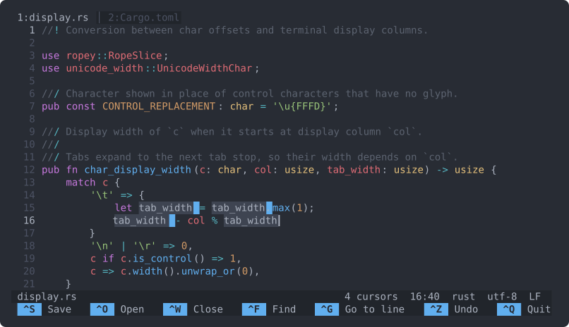

# lite

Text editor terminal untuk kamu yang ingin `Ctrl+S` untuk menyimpan dan `Ctrl+F` untuk mencari.

Tidak ada mode yang perlu dihafal. Buka file, langsung mengetik, dan shortcut yang paling sering dipakai tertulis di bagian bawah layar. Tombolnya mengikuti Sublime Text, jadi kalau kamu pernah memakainya, multi-cursor dengan `Ctrl+D` bekerja dengan cara yang sama.

<p align="center">
  
</p>

<p align="center">
  
  
  
</p>

<p align="center">
  <a href="README.md">English</a> · <b>Bahasa Indonesia</b>
</p>

---

## Daftar isi

- [Yang kamu dapat](#yang-kamu-dapat)
- [Instalasi](#instalasi)
- [Cara pakai](#cara-pakai)
- [Shortcut keyboard](#shortcut-keyboard)
- [Konfigurasi](#konfigurasi)
- [Shell completion](#shell-completion)
- [Keterbatasan saat ini](#keterbatasan-saat-ini)
- [Troubleshooting](#troubleshooting)
- [Uninstall](#uninstall)
- [Development](#development)

## Yang kamu dapat

- Simpan, buka, cari, ganti, undo, dan keluar memakai tombol yang sama dengan editor desktop. Baris di bawah layar menampilkan shortcut-shortcut itu, dan isinya dibaca dari key binding yang aktif, jadi tidak pernah menampilkan shortcut yang tidak berfungsi.
- `Ctrl+D` memilih kata di bawah cursor, lalu menambahkan setiap kemunculan berikutnya sebagai cursor baru; `Alt+Shift+↑/↓` menambah cursor di baris atas atau bawah. Mengetik, menghapus, dan paste terjadi di semua cursor sekaligus.
- Setiap file terbuka di tab sendiri. Jendela bisa di-split kiri-kanan atau atas-bawah, dan tiap bagian bisa menampilkan file yang berbeda.
- Rust, Python, JavaScript, TypeScript, Go, C, C++, JSON, Bash, HTML, CSS, dan Markdown mendapat syntax highlighting lewat tree-sitter. File lain dibuka sebagai teks biasa.
- Saat menyimpan, isi file ditulis ke file sementara dulu lalu ditukar, jadi kalau terjadi crash tidak akan ada file yang setengah tertulis. Permission dan symlink tetap terjaga. Keluar atau menutup tab yang belum disimpan meminta kamu menekan tombolnya sekali lagi.
- Satu kali `Ctrl+Z` membatalkan satu kata yang baru diketik, bukan satu huruf.
- Huruf beraksen, karakter CJK, emoji, dan tab bisa digeser, dipilih, dan tampil rata dengan benar.

## Instalasi

lite berjalan di Linux. Untuk build dibutuhkan `git`, compiler C (untuk grammar tree-sitter), dan Rust. Script instalasi cepat akan memasang Rust kalau belum ada.

### Instalasi cepat

```bash
curl -fsSL https://raw.githubusercontent.com/IrfanArsyad/lite/main/scripts/install.sh | bash
```

Script ini memakai binary siap pakai kalau sudah ada release untuk platform kamu, dan build dari source kalau belum. `lite` disalin ke `/usr/local/bin` beserta man page dan shell completion, jadi script akan meminta `sudo`.

### Dari source

```bash
git clone https://github.com/IrfanArsyad/lite.git
cd lite
make install
```

Tanpa `make`:

```bash
cargo build --release
sudo cp target/release/lite /usr/local/bin/
```

### Lewat Cargo

```bash
cargo install --git https://github.com/IrfanArsyad/lite.git lite-term
```

Binary `lite` akan terpasang di `~/.cargo/bin`.

### Sebagai paket .deb

```bash
git clone https://github.com/IrfanArsyad/lite.git
cd lite
make deb                                  # memasang cargo-deb kalau belum ada
sudo apt install ./target/debian/lite_*.deb
```

Cek hasilnya:

```bash
lite --version
```

## Cara pakai

```bash
lite                  # mulai dengan buffer kosong
lite catatan.md       # buka file; file yang belum ada akan dibuat saat pertama disimpan
lite src/*.rs         # buka beberapa file, satu tab per file
lite --update         # update ke release terbaru
lite --help           # daftar opsi dan lokasi file config
```

Di dalam editor, tekan `Ctrl+S` untuk menyimpan dan `Ctrl+Q` untuk keluar. Menyimpan buffer yang belum punya nama akan menanyakan nama file.

## Shortcut keyboard

Kalau satu baris berisi dua tombol yang dipisah "atau", keduanya sama-sama bisa dipakai.

`Ctrl+Shift` plus huruf (misalnya `Ctrl+Shift+S`), `Ctrl+Tab`, `Ctrl+Enter`, dan `Ctrl+/` hanya berfungsi di terminal yang mengirimnya sebagai tombol terpisah lewat kitty keyboard protocol. lite menyalakan protokol ini sendiri di kitty, foot, Ghostty, Alacritty 0.13 ke atas, dan WezTerm dengan `enable_kitty_keyboard = true`. Kebanyakan terminal lain, dan apa pun yang berjalan di dalam tmux, mengirim `Ctrl+Shift+S` sebagai `Ctrl+S` biasa; di sana pakai alternatif yang ada di tabel, misalnya `Ctrl+Y` untuk redo. `Ctrl+Shift` dengan tombol panah berfungsi di semua terminal.

### File

| Shortcut | Aksi |
|----------|------|
| `Ctrl+S` | Simpan |
| `Ctrl+Shift+S` | Simpan sebagai |
| `Ctrl+O` | Buka file |
| `Ctrl+W` | Tutup tab |
| `Ctrl+Q` | Keluar |

### Mengedit

| Shortcut | Aksi |
|----------|------|
| `Ctrl+Z` | Undo |
| `Ctrl+Y` atau `Ctrl+Shift+Z` | Redo |
| `Ctrl+C` / `Ctrl+X` / `Ctrl+V` | Copy / cut / paste (satu baris penuh kalau tidak ada yang dipilih) |
| `Ctrl+Shift+K` | Hapus baris |
| `Ctrl+Shift+D` | Duplikat baris |
| `Ctrl+Shift+↑` / `Ctrl+Shift+↓` | Pindahkan baris ke atas / bawah |
| `Tab` / `Shift+Tab` | Indent / unindent (baris yang dipilih, atau sisipkan indent di cursor) |
| `Ctrl+/` | Toggle komentar, sesuai gaya komentar bahasa file tersebut |
| `Ctrl+Enter` / `Ctrl+Shift+Enter` | Baris baru di bawah / di atas |

### Seleksi dan multi-cursor

| Shortcut | Aksi |
|----------|------|
| `Ctrl+A` | Pilih semua |
| `Ctrl+L` | Pilih baris |
| `Ctrl+D` | Pilih kata, lalu tambahkan kemunculan berikutnya |
| `Ctrl+Shift+A` | Pilih semua kemunculan |
| `Ctrl+Shift+L` | Pecah seleksi jadi satu cursor per baris |
| `Alt+Shift+↑` / `Alt+Shift+↓` | Tambah cursor di atas / bawah |
| `Esc` | Kembali ke satu cursor |

### Navigasi

| Shortcut | Aksi |
|----------|------|
| `Ctrl+←` / `Ctrl+→` | Kata sebelumnya / berikutnya |
| `Home` / `End` | Awal / akhir baris |
| `Ctrl+Home` / `Ctrl+End` | Awal / akhir file |
| `PageUp` / `PageDown` | Naik / turun satu layar |
| `Ctrl+G` | Pergi ke baris (`42`, atau `42:7` untuk baris dan kolom) |

### Pencarian

| Shortcut | Aksi |
|----------|------|
| `Ctrl+F` | Cari |
| `F3` / `Shift+F3` | Hasil berikutnya / sebelumnya |
| `Ctrl+E` | Cari teks yang sedang dipilih |
| `Ctrl+H` | Ganti semua kemunculan di file |

### Tab dan split

| Shortcut | Aksi |
|----------|------|
| `Ctrl+PageDown` atau `Ctrl+Tab` | Tab berikutnya |
| `Ctrl+PageUp` atau `Ctrl+Shift+Tab` | Tab sebelumnya |
| `Alt+1` … `Alt+9` atau `Ctrl+1` … `Ctrl+9` | Pindah ke tab 1 sampai 9 |
| `Alt+\` atau `Ctrl+\` | Split kiri-kanan |
| `Alt+-` atau `Ctrl+Shift+\` | Split atas-bawah |
| `F6` / `Shift+F6` | Pindah ke split berikutnya / sebelumnya |
| `Ctrl+Shift+W` | Tutup split yang aktif |

Kebanyakan terminal tidak meneruskan `Ctrl+Tab`, `Ctrl+1` … `Ctrl+9`, atau `Ctrl+\` ke program yang berjalan di dalamnya. Shortcut `Alt`, `F6`, dan `Ctrl+PageUp`/`Ctrl+PageDown` berfungsi di semua terminal.

### Mouse

Klik untuk memindahkan cursor atau berpindah split, dan scroll dengan roda mouse. Matikan dengan `mouse = false` kalau kamu lebih suka seleksi teks bawaan terminal.

## Konfigurasi

lite membaca `~/.config/lite/config.toml` (jalankan `lite --help` untuk melihat lokasi pastinya di sistem kamu). File ini opsional, begitu juga setiap pengaturan di dalamnya.

```toml
[editor]
tab_width = 4            # lebar tab, sekaligus satu level indentasi
indent_style = "spaces"  # "spaces" atau "tabs"
mouse = true             # klik untuk memindah cursor, roda mouse untuk scroll
scrolloff = 5            # jumlah baris yang tetap terlihat di atas dan bawah cursor
```

Kalau ada kesalahan di file ini, lite tetap berjalan dengan pengaturan default dan menampilkan pesan error-nya di status line.

## Shell completion

Completion untuk bash, zsh, dan fish dipasang oleh `make install` dan oleh script instalasi cepat. Completion ini melengkapi nama file serta opsi `--help`, `--version`, dan `--update`.

Untuk zsh, file-nya dipasang ke `/usr/share/zsh/vendor-completions` di Debian dan Ubuntu, dan ke `/usr/share/zsh/site-functions` di distro lain; keduanya sudah dibaca zsh secara default. Kalau kamu mengatur completion sendiri (misalnya dengan oh-my-zsh), salin `completions/_lite` ke salah satu folder di `fpath`, lalu jalankan:

```zsh
rm -f ~/.zcompdump; compinit
```

## Keterbatasan saat ini

lite masih di versi 0.1.0. Ini yang belum ada:

- Belum bisa memilih teks dengan `Shift` + tombol panah. Pakai `Ctrl+L`, `Ctrl+D`, atau mouse.
- Dukungan language server (autocomplete, go to definition), penanda Git, quick open, dan command palette masih direncanakan. Shortcut-nya menampilkan pesan "not available yet" di status line.
- Hanya file UTF-8 yang bisa dibuka. File binary ditolak supaya tidak rusak.
- Di terminal tanpa kitty keyboard protocol, `Ctrl+Shift` plus huruf terbaca sebagai `Ctrl` biasa (lihat [Shortcut keyboard](#shortcut-keyboard)), dan `Ctrl+/` terbaca sebagai `Ctrl+7`, sehingga pindah ke tab 7, bukan toggle komentar.
- Baru diuji di Linux.

## Troubleshooting

**`lite: command not found` setelah instalasi.** `/usr/local/bin` belum ada di `PATH`. Tambahkan ke file startup shell kamu:

```bash
# zsh
echo 'export PATH="/usr/local/bin:$PATH"' >> ~/.zshrc && source ~/.zshrc

# bash
echo 'export PATH="/usr/local/bin:$PATH"' >> ~/.bashrc && source ~/.bashrc
```

Kalau kamu install lewat Cargo, binary-nya ada di `~/.cargo/bin`; `source ~/.cargo/env` menambahkannya untuk shell yang sedang terbuka.

**`cargo: command not found` saat build.** Pasang Rust dengan rustup, lalu buka terminal baru:

```bash
curl --proto '=https' --tlsv1.2 -sSf https://sh.rustup.rs | sh
```

**`linker 'cc' not found` atau error build tree-sitter.** Grammar-nya ditulis dalam C. Di Debian dan Ubuntu, `sudo apt install build-essential`; di Fedora, `sudo dnf install gcc`; di Arch, `sudo pacman -S base-devel`.

**Shortcut tidak bereaksi.** Terminal, tmux, atau desktop kamu mungkin menangkap tombol itu sebelum sampai ke lite. Coba alternatifnya di [Tab dan split](#tab-dan-split), atau hapus binding yang bentrok di pengaturan terminal.

## Uninstall

| Dipasang dengan | Hapus dengan |
|-----------------|--------------|
| `make install` | `make uninstall` (dari folder repository) |
| Script instalasi cepat | `curl -fsSL https://raw.githubusercontent.com/IrfanArsyad/lite/main/scripts/uninstall.sh \| bash` |
| Cargo | `cargo uninstall lite-term` |
| Paket .deb | `sudo apt remove lite` |

File config di `~/.config/lite` tidak ikut dihapus; hapus manual kalau sudah tidak dipakai.

## Development

```bash
git clone https://github.com/IrfanArsyad/lite.git
cd lite
make build     # debug build
make run       # build lalu jalankan lite
make test      # jalankan test
make lint      # clippy
make fmt       # rustfmt
```

Kodenya berupa Cargo workspace:

```
lite/
├── lite-core/     primitif teks: helper rope, seleksi, transaksi, lebar tampilan
├── lite-view/     state editor: dokumen, riwayat undo, view, layout split, syntax tree
├── lite-ui/       widget ratatui: editor, tab line, status line, help bar, prompt
├── lite-term/     binary lite: event loop, penanganan tombol, perintah edit
├── lite-config/   pengaturan, key binding, tema
├── lite-lsp/      placeholder untuk dukungan language server
└── lite-git/      placeholder untuk integrasi Git
```

### Kontribusi

Laporan bug dan pull request sangat diterima.

1. Fork repository ini dan buat branch (`git checkout -b fix/deskripsi-singkat`).
2. Buat perubahan dan tambahkan test-nya.
3. Jalankan `make test` dan `make lint` sebelum push.
4. Buka pull request yang menjelaskan apa yang berubah dan alasannya.

## Lisensi

MIT. Lihat [LICENSE](LICENSE).
